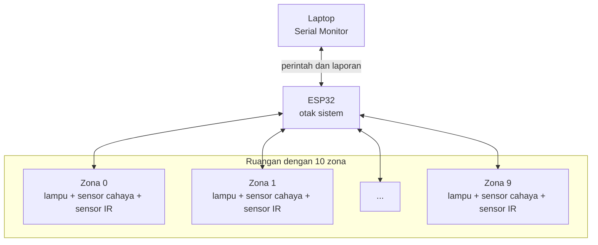

# Bab 1 — Gambaran Besar

## Sistem ini ngapain sih?

Bayangkan sebuah **ruangan besar yang dibagi menjadi 10 area** (kita sebut **zona**). Misalnya ruang kerja dengan 10 meja.

Setiap meja punya:

1. **Lampu** di atasnya, yang terangnya bisa diatur (bukan cuma nyala/mati).
2. **"Mata" pengukur cahaya** (sensor BH1750), untuk tahu seberapa terang meja itu.
3. **"Mata" pendeteksi orang** (sensor IR HW-201), untuk tahu ada orang atau tidak.

Lalu ada satu **"otak"** (ESP32) yang membaca semua sensor dan mengatur semua lampu.



## Kenapa disebut "adaptive" (adaptif)?

Karena lampunya **menyesuaikan diri**.

> **Perumpamaan:** Kamu duduk dekat jendela. Pagi hari, matahari masuk, meja sudah terang, jadi lampu cukup redup. Sore hari, matahari hilang, meja mulai gelap, jadi lampu otomatis lebih terang. Hasilnya: meja **selalu** punya terang yang nyaman, dan listrik tidak terbuang.

Itulah yang dilakukan **mode KONTROL**.

## Empat Mode

Sistem ini seperti mobil yang punya beberapa "gigi". Setiap saat hanya satu mode yang aktif.

| Mode | Perumpamaan | Yang terjadi |
|---|---|---|
| **MANUAL** | Saklar dimmer biasa di dinding | Kamu sendiri yang mengatur terang tiap lampu |
| **KONTROL** | AC dengan termostat | Sistem menjaga terang meja tetap di target, misalnya 300–400 lux |
| **KALIBRASI** | Menyetel timbangan dapur dengan anak timbangan resmi | Sensor murah "dicocokkan" dengan alat ukur akurat (luxmeter) |
| **MANUAL_IR** | Lampu toilet mall yang nyala saat ada orang | Lampu zona menyala saat ada orang, mati sendiri setelah beberapa detik |

## Bagaimana kita berbicara dengan sistem?

Lewat **Serial Monitor** di laptop, dengan mengetik perintah teks. Seperti chatting dengan sistemnya:

```
Kamu   : status
Sistem : ---------- STATUS ----------
         Mode      : MANUAL
         PWM maks  : 100 (~2.4%)
         ...
Kamu   : 3 50
Sistem : Zona 3 -> 50 (~1.2%)
```

## Satuan yang sering muncul

| Istilah | Arti sederhana | Contoh |
|---|---|---|
| **lux (lx)** | Ukuran seberapa terang cahaya yang jatuh di permukaan | Ruang tamu ~150 lx, kantor ~300–500 lx, siang di luar ~10.000+ lx |
| **PWM** | Angka 0–4095 yang menentukan terang lampu | 0 = mati, 4095 = paling terang |
| **zona** | Nomor area/meja, 0 sampai 9 | "zona 3" = meja ke-4 (karena mulai dari 0) |

> **Kenapa mulai dari 0?** Di pemrograman, urutan biasanya dihitung dari 0. Jadi 10 zona = zona 0, 1, 2, ..., 9.

## Rangkuman Bab 1

- Ada **10 zona**, masing-masing punya lampu, sensor cahaya, dan sensor IR.
- **ESP32** adalah otaknya, kita mengaturnya lewat **Serial Monitor**.
- Ada **4 mode**: MANUAL, KONTROL, KALIBRASI, MANUAL_IR.

Lanjut ke [Bab 2 — Perangkat Keras, I2C, dan PWM](02-perangkat-keras.md).
