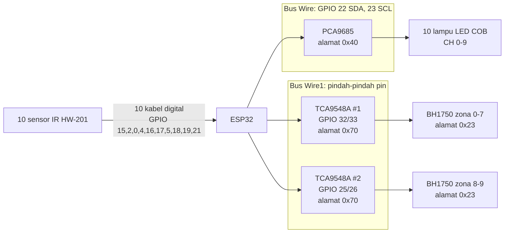
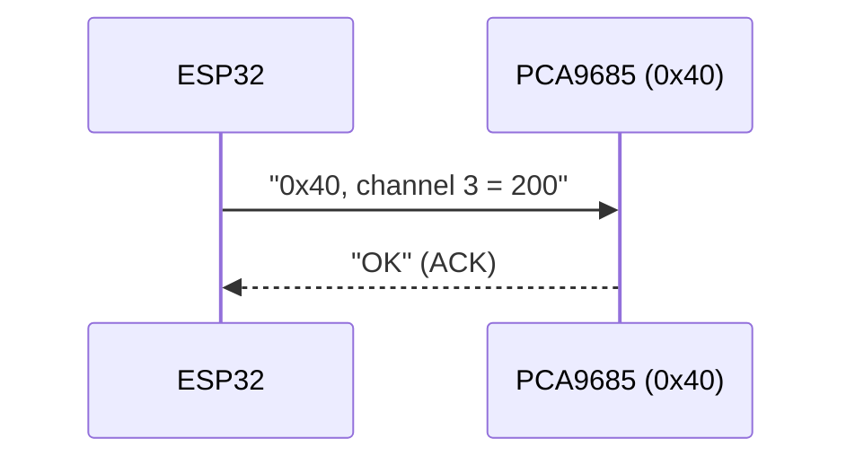
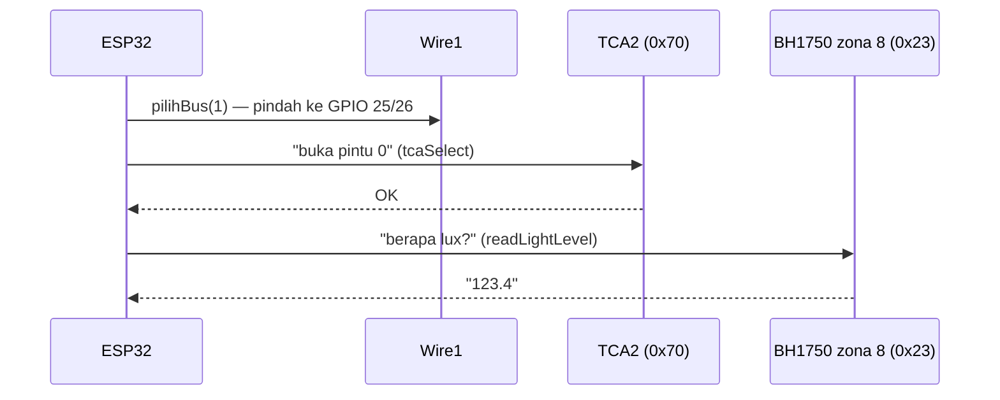
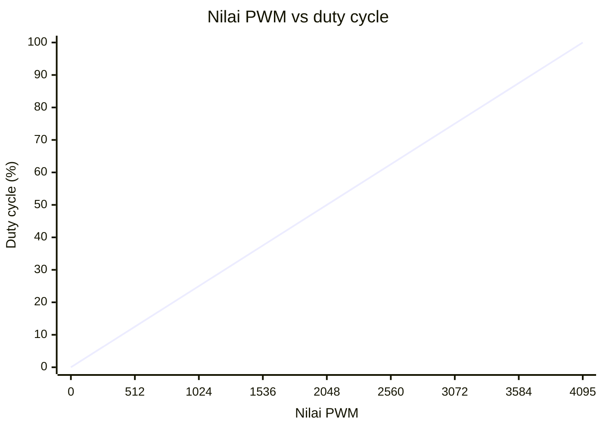

# Bab 2 — Perangkat Keras, I2C, dan PWM

Di bab ini kita lihat **bagaimana ESP32 terhubung** ke lampu dan sensor, dan **bahasa apa** yang dipakai untuk berkomunikasi.

## 2.1 Daftar Pemain

| Komponen | Peran | Perumpamaan |
|---|---|---|
| **ESP32** | Mikrokontroler, menjalankan program | Manajer kantor |
| **PCA9685** | Mengatur terang 16 lampu sekaligus | Asisten yang memegang 16 tombol dimmer |
| **TCA9548A** (2 buah) | Memilih sensor mana yang diajak bicara | Operator telepon / resepsionis |
| **BH1750** (10 buah) | Mengukur cahaya (lux) | Pengukur cahaya di tiap meja |
| **HW-201** (10 buah) | Mendeteksi benda/orang di depannya | Bel pintu otomatis |

## 2.2 Peta Kabel



Ada **3 jalur** komunikasi:

1. **Bus I2C `Wire`** ke PCA9685, untuk lampu.
2. **Bus I2C `Wire1`** ke dua TCA9548A, lalu ke 10 sensor cahaya.
3. **10 kabel digital biasa** dari sensor IR, masing-masing ke satu pin ESP32.

---

## 2.3 Apa itu I2C?

I2C adalah cara ESP32 berbicara dengan banyak perangkat **hanya memakai 2 kabel**: SDA (data) dan SCL (clock / "ketukan irama").

> **Perumpamaan: grup WhatsApp.**
> Semua perangkat ada di satu grup (satu pasang kabel). Setiap perangkat punya **nomor unik** (alamat, misalnya `0x40`). ESP32 menulis pesan dengan menyebut nomornya: "Hei 0x40, nyalakan lampu 3!" Semua anggota grup "mendengar", tapi hanya yang dipanggil yang menjawab.



### Masalahnya: 10 sensor dengan nomor yang sama!

Semua BH1750 punya alamat `0x23`. Kalau ESP32 memanggil "Hei 0x23!", **10 sensor menjawab bersamaan**, dan jawabannya kacau.

> **Perumpamaan:** Di kelas ada 10 anak bernama "Budi". Guru memanggil "Budi!", dan semua berdiri.

### Solusinya: TCA9548A (multiplexer)

TCA9548A punya **8 pintu (channel)**. Ia hanya membuka satu pintu sekaligus, sehingga hanya satu sensor yang "terdengar".

> **Perumpamaan: resepsionis hotel.** Kamu menelepon hotel lalu bilang "sambungkan ke kamar 3". Resepsionis menyambungkan kamu ke kamar 3 saja. Baru setelah itu kamu bilang "Halo Budi" dan hanya Budi di kamar 3 yang menjawab.

Di kode, "minta disambungkan ke kamar" adalah fungsi `tcaSelect()`:

```cpp
bool tcaSelect(uint8_t modul, uint8_t ch) {
  pilihBus(modul);                 // pilih TCA yang mana (1 atau 2)
  Wire1.beginTransmission(TCA_ADDR);
  Wire1.write(1 << ch);            // buka pintu nomor ch
  return Wire1.endTransmission() == 0;
}
```

`1 << ch` artinya "angka 1 digeser ke kiri sebanyak ch". Hasilnya adalah angka biner dengan **satu bit menyala** di posisi `ch`:

| ch | `1 << ch` (biner) | Pintu yang terbuka |
|---|---|---|
| 0 | `00000001` | pintu 0 |
| 3 | `00001000` | pintu 3 |
| 7 | `10000000` | pintu 7 |

### Masalah kedua: TCA juga punya nomor yang sama

Satu TCA hanya punya 8 pintu, padahal ada 10 sensor, jadi dipakai **2 TCA**. Tapi keduanya beralamat `0x70`! Solusinya: kedua TCA **dipasang di kabel yang berbeda**, dan ESP32 **memindahkan `Wire1`** ke kabel yang sesuai.

> **Perumpamaan:** Ada dua hotel, dan resepsionis keduanya bernama "Rina". Kamu tidak bisa menelepon keduanya di satu telepon. Jadi kamu punya **satu telepon** (`Wire1`) yang kabelnya kamu **cabut-pasang** ke jalur hotel A atau hotel B sesuai kebutuhan.

Itu dilakukan oleh `pilihBus()`:

```cpp
void pilihBus(uint8_t modul) {
  if (busAktif == modul) return;     // sudah di jalur yang benar, tidak usah pindah
  if (busAktif >= 0) Wire1.end();    // cabut dari jalur lama
  Wire1.begin(BUS_SDA[modul], BUS_SCL[modul], I2C_FREQ_SENSOR);  // pasang ke jalur baru
  busAktif = modul;                  // ingat sedang di jalur mana
}
```

### Alur lengkap membaca satu sensor

Misalnya membaca **zona 8** (TCA2, pintu 0):



Tabel "alamat lengkap" setiap zona ada di kode sebagai dua array:

```cpp
const uint8_t SENSOR_TCA[NUM_CH] = {0, 0, 0, 0, 0, 0, 0, 0, 1, 1};  // TCA ke berapa
const uint8_t SENSOR_CH[NUM_CH]  = {0, 1, 2, 3, 4, 5, 6, 7, 0, 1};  // pintu ke berapa
```

Cara membacanya: kolom ke-z dari kedua array. Zona 8 → `SENSOR_TCA[8] = 1` (TCA2), `SENSOR_CH[8] = 0` (pintu 0).

---

## 2.4 Apa itu PWM?

LED tidak bisa "setengah nyala" seperti lampu pijar yang diredupkan. Triknya: LED **dinyalakan dan dimatikan sangat cepat**. Mata kita tidak melihat kedipnya, yang terasa hanya rata-rata terangnya.

> **Perumpamaan:** Kipas angin yang tombolnya kamu tekan ON-OFF-ON-OFF dengan sangat cepat. Kalau lebih lama ON, anginnya terasa lebih kencang. Kalau lebih lama OFF, terasa pelan.

Perbandingan waktu ON terhadap total disebut **duty cycle**:

```
PWM   0 / 4095  (0%)    ____________________________   mati

PWM 1024 / 4095 (25%)   ‾‾‾‾‾‾‾______________________   redup
                        |<-ON->|<-------OFF-------->|

PWM 2048 / 4095 (50%)   ‾‾‾‾‾‾‾‾‾‾‾‾‾‾______________   setengah
                        |<---ON----->|<----OFF---->|

PWM 4095 / 4095 (100%)  ‾‾‾‾‾‾‾‾‾‾‾‾‾‾‾‾‾‾‾‾‾‾‾‾‾‾‾‾   terang penuh

                        |<-------- 1 ms (1000 Hz) ------->|
```

- PCA9685 punya resolusi **12-bit**, artinya ada **4096 tingkat** (0 sampai 4095).
- Frekuensinya **1000 Hz** (`PWM_FREQ`), artinya ON-OFF terjadi 1000 kali per detik. Cukup cepat agar tidak terlihat berkedip, termasuk di kamera HP.

### Grafik: nilai PWM vs persen terang



Rumus di kode: `persen = nilai * 100.0 / 4095.0`.

### Rem tangan: `pwmMaks`

Ada satu "pengaman" penting: **`pwmMaks`** (default **100**, cuma ~2,4%). Setiap nilai PWM yang lebih besar dari ini akan dipotong.

> **Perumpamaan:** Seperti **limiter kecepatan** di mobil rental. Mau injak gas sedalam apa pun, mobil tidak akan lebih dari 80 km/jam.

Semua perintah ke lampu **wajib lewat** `setChannel()`, yang memasang limiter ini:

```cpp
void setChannel(uint8_t ch, uint16_t nilai) {
  if (nilai > pwmMaks) nilai = pwmMaks;   // limiter
  nilaiCh[ch] = nilai;                    // catat nilainya (untuk ditampilkan nanti)
  pwm.setPin(PIN_MAP[ch], nilai);         // kirim ke PCA9685
}
```

Contoh: `pwmMaks = 100`, lalu kamu ketik `3 500`. Lampu zona 3 hanya akan mendapat **100**.

---

## 2.5 Sensor IR HW-201

Sensor ini paling sederhana: outputnya hanya **HIGH** atau **LOW**.

| Kondisi | Output pin |
|---|---|
| Tidak ada benda | HIGH (1) |
| Ada benda di depan sensor | **LOW (0)** |

> Perhatikan: **LOW = terdeteksi** (terbalik dari yang mungkin kamu duga). Ini disebut "active low". Di kode, ditulis sebagai `#define IR_AKTIF LOW` supaya mudah dibaca.

Pin dipasang `INPUT_PULLUP`, artinya ESP32 "menarik" pin ke HIGH secara default. Jadi kalau kabel sensor lepas, pin terbaca HIGH = "tidak ada orang", sehingga lampu tidak menyala sembarangan.

> **Catatan penting:** Beberapa pin IR (GPIO 0, 2, 5, 15) adalah *pin strapping* ESP32, yang menentukan mode saat ESP32 menyala. Lihat [Task 01](../../tasks/01-pin-strapping-ir.md).

## Rangkuman Bab 2

- **I2C** = grup chat 2 kabel; setiap perangkat punya alamat.
- **TCA9548A** = resepsionis yang menyambungkan ke satu sensor saja, karena semua sensor beralamat sama.
- Karena kedua TCA juga beralamat sama, **`Wire1` dipindah-pindah pinnya** dengan `pilihBus()`.
- **PWM** = nyala-mati sangat cepat; 0–4095; dibatasi oleh **`pwmMaks`** lewat `setChannel()`.
- **IR**: LOW = ada orang.

Lanjut ke [Bab 3 — Alur Program](03-alur-program.md).
