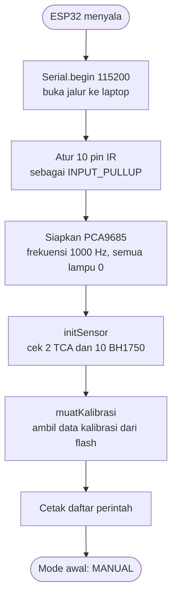
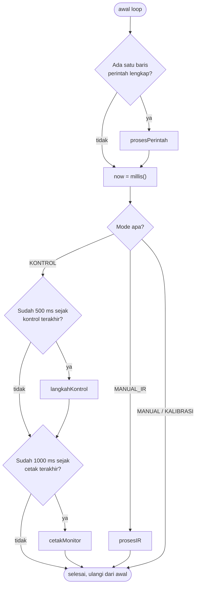

# Bab 3 — Alur Program

Setiap program Arduino punya dua fungsi wajib:

- **`setup()`**: dijalankan **sekali** saat ESP32 menyala.
- **`loop()`**: dijalankan **berulang-ulang terus** sampai listrik dicabut.

> **Perumpamaan: membuka warung.**
> `setup()` = pagi hari: buka rolling door, nyalakan lampu, tata dagangan, cek stok. Sekali saja.
> `loop()` = sepanjang hari: lihat ada pembeli? layani. Cek gorengan sudah matang? angkat. Ulangi, ulangi, ulangi...

## 3.1 `setup()`: persiapan pagi



Contoh output yang muncul di Serial Monitor saat boot:

```
=== Adaptive Lighting 10 Zona: PCA9685 + 2x TCA9548A + 10x BH1750 + 10x IR ===
TCA1 (SDA 32, SCL 33) terdeteksi
TCA2 (SDA 25, SCL 26) terdeteksi
  Zona 0 -> TCA1 CH0 : BH1750 OK
  Zona 1 -> TCA1 CH1 : BH1750 OK
  ...
  Zona 9 -> TCA2 CH1 : BH1750 OK
Kalibrasi dimuat: GAIN 1.1763  OFFSET 1.36
========== PERINTAH ==========
...
>> Mode awal: MANUAL
```

Kalau ada sensor yang tertulis `BH1750 GAGAL`, artinya sensor itu tidak terjawab saat boot dan **akan terus dianggap rusak** sampai ESP32 di-reset (lihat [Task 05](../../tasks/05-sensor-gagal-tidak-dicoba-ulang.md)).

## 3.2 `loop()`: kesibukan sepanjang hari

```cpp
void loop() {
  String baris;
  if (bacaBaris(baris)) prosesPerintah(baris);   // 1. ada perintah dari laptop?

  unsigned long now = millis();                  // 2. jam berapa sekarang?

  if (mode == MODE_KONTROL) {                    // 3. kerjakan tugas sesuai mode
    if (now - tKontrol >= CONTROL_INTERVAL) { tKontrol = now; langkahKontrol(); }
    if (now - tPrint   >= PRINT_INTERVAL)   { tPrint   = now; cetakMonitor();   }
  } else if (mode == MODE_MANUAL_IR) {
    prosesIR(now);
  }
}
```



`loop()` berjalan **ribuan kali per detik**. Sebagian besar putaran tidak mengerjakan apa-apa, hanya "melirik jam" lalu lewat.

## 3.3 Trik `millis()`: kenapa tidak pakai `delay()`?

Cara paling gampang membuat sesuatu terjadi tiap 500 ms adalah:

```cpp
// JANGAN begini
void loop() {
  langkahKontrol();
  delay(500);   // ESP32 "tidur" setengah detik
}
```

Masalahnya: selama `delay()`, ESP32 **tidak bisa melakukan apa pun**, termasuk membaca perintah dari laptop.

> **Perumpamaan: memasak mi.**
> **Cara `delay()`:** kamu berdiri menatap panci selama 3 menit, tidak bisa melakukan hal lain. Kalau ada tamu mengetuk pintu, kamu tidak dengar.
> **Cara `millis()`:** kamu lihat jam: "mulai masak jam 12:00". Lalu kamu cuci piring, angkat telepon, buka pintu. Sesekali lirik jam: "sudah 12:03? angkat mi!"

Itulah pola yang dipakai di kode:

```cpp
if (now - tKontrol >= CONTROL_INTERVAL) {   // sudah lewat 500 ms?
  tKontrol = now;                           // catat jam sekarang
  langkahKontrol();                         // kerjakan
}
```

### Contoh hitungan

`millis()` = berapa milidetik sejak ESP32 menyala.

| Putaran | `now` | `tKontrol` | `now - tKontrol` | ≥ 500? | Aksi |
|---|---|---|---|---|---|
| 1 | 10 000 | 10 000 | 0 | tidak | - |
| ... | ... | ... | ... | ... | - |
| ke-n | 10 499 | 10 000 | 499 | tidak | - |
| ke-n+1 | 10 500 | 10 000 | 500 | **ya** | kontrol, `tKontrol = 10 500` |
| ... | 10 800 | 10 500 | 300 | tidak | - |
| ... | 11 000 | 10 500 | 500 | **ya** | kontrol, `tKontrol = 11 000` |

### Bonus: aman dari "jam kembali ke nol"

`millis()` disimpan dalam angka 32-bit, jadi setelah ~49,7 hari ia kembali ke 0 (seperti odometer motor tua yang kembali ke 00000). Karena kode memakai **pengurangan** (`now - tKontrol`), hasilnya tetap benar walaupun jam sudah "berputar". Ini trik standar di dunia Arduino.

## 3.4 Membaca perintah dari laptop: `bacaBaris()`

Data dari Serial datang **satu huruf demi satu huruf**, bukan langsung satu kalimat.

> **Perumpamaan:** Teman mengirim pesan dengan mengetik satu huruf per detik. Kamu kumpulkan hurufnya di kertas, dan baru membaca pesannya saat dia menekan **Enter**.

```cpp
bool bacaBaris(String &out) {
  while (Serial.available()) {          // selama ada huruf yang masuk
    char c = Serial.read();             // ambil satu huruf
    if (c == '\n' || c == '\r') {       // Enter?
      if (bufferInput.length() > 0) {   // ada isinya?
        out = bufferInput;              // serahkan kalimatnya
        bufferInput = "";               // kosongkan kertas
        return true;
      }
    } else if (bufferInput.length() < 64) {
      bufferInput += c;                 // tempel huruf ke kertas (maks 64 huruf)
    }
  }
  return false;                         // belum ada kalimat lengkap
}
```

Contoh kamu mengetik `3 50` lalu Enter:

| Huruf masuk | `bufferInput` | Hasil |
|---|---|---|
| `3` | `"3"` | false |
| ` ` | `"3 "` | false |
| `5` | `"3 5"` | false |
| `0` | `"3 50"` | false |
| `\n` | `""` | **true**, `out = "3 50"` |

Kalimat lebih dari 64 huruf: sisanya **dibuang diam-diam**.

## Rangkuman Bab 3

- `setup()` = persiapan sekali; `loop()` = berulang terus.
- Tugas berkala memakai **`millis()`**, bukan `delay()`, supaya ESP32 tetap responsif.
- `bacaBaris()` mengumpulkan huruf sampai Enter, lalu `prosesPerintah()` menjalankannya.
- Pengecualian: saat **mengambil titik kalibrasi**, ESP32 memang sengaja "menunggu" ~1 detik (`delay(130)` × 8).

Lanjut ke [Bab 4 — Mode dan Perintah Serial](04-mode-dan-perintah.md).
