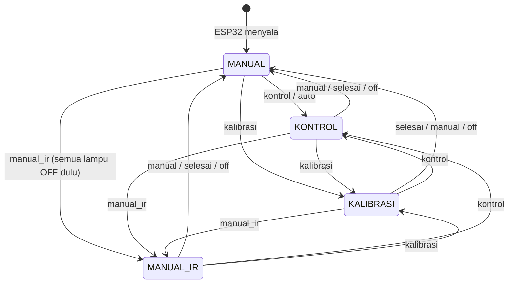
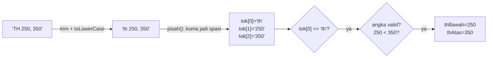
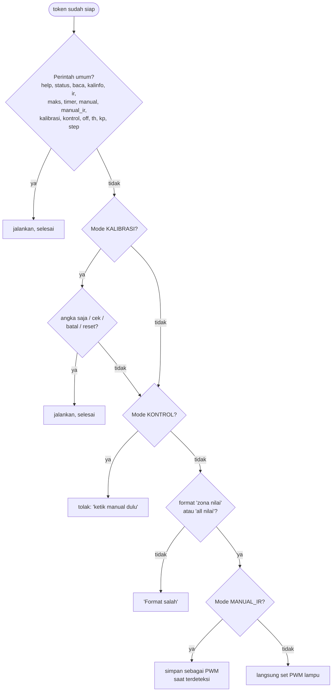

# Bab 4 — Mode dan Perintah Serial

## 4.1 Mode = "keadaan" sistem

Di kode, mode disimpan dalam satu variabel:

```cpp
enum Mode { MODE_MANUAL, MODE_KONTROL, MODE_KALIBRASI, MODE_MANUAL_IR };
Mode mode = MODE_MANUAL;
```

`enum` adalah cara memberi **nama** pada angka. Di balik layar `MODE_MANUAL = 0`, `MODE_KONTROL = 1`, dst., tapi memakai nama membuat kode jauh lebih mudah dibaca.

> **Perumpamaan:** Mesin cuci punya kenop: *Cuci*, *Bilas*, *Peras*, *Kering*. Kenopnya hanya bisa menunjuk satu posisi. Mesin melakukan pekerjaan berbeda tergantung posisi kenop.

### Diagram perpindahan mode



Hal yang perlu diingat:

| Perintah | Lampu yang sedang menyala |
|---|---|
| `manual`, `selesai`, `kontrol`, `kalibrasi` | **Dibiarkan** di nilai terakhir |
| `off` | **Dimatikan semua**, lalu pindah ke MANUAL |
| `manual_ir` | **Dimatikan semua**, lalu pindah ke MANUAL_IR |

## 4.2 Perjalanan sebuah perintah

Misalnya kamu mengetik `TH 250, 350`. Begini perjalanannya di `prosesPerintah()`:



### Langkah 1: Rapikan

- `trim()` membuang spasi di awal dan akhir.
- `toLowerCase()` mengubah ke huruf kecil, jadi `STATUS`, `Status`, dan `status` dianggap sama.

### Langkah 2: Potong jadi token, `pisah()`

Token = "potongan kata". Kalimat dipotong di setiap spasi, maksimal 3 potongan.

> **Perumpamaan:** Memotong roti tawar panjang menjadi beberapa iris di setiap garis spasi.

| Input | `tok[0]` | `tok[1]` | `tok[2]` | `n` |
|---|---|---|---|---|
| `status` | `status` | | | 1 |
| `3 50` | `3` | `50` | | 2 |
| `th 300,400` | `th` | `300` | `400` | 3 |
| `step  1   5` | `step` | `1` | `5` | 3 |

### Langkah 3: Cocokkan dengan daftar perintah

Kode memeriksa `tok[0]` satu per satu dari atas ke bawah, seperti petugas yang mencocokkan tiket dengan daftar:



Urutan ini penting! Contoh:

- Di mode **KALIBRASI**, mengetik `152` (satu angka) berarti "nilai luxmeter = 152".
- Di mode **MANUAL**, mengetik `152` saja berarti **format salah** (butuh `<zona> <nilai>`).
- Di mode **KONTROL**, `3 50` **ditolak**, karena lampu sedang diatur otomatis. Bayangkan dua orang memegang setir mobil yang sama.

## 4.3 Satpam angka: `isAngka()` dan `isDesimal()`

Sebelum angka dipakai, kode memastikan teksnya benar-benar angka.

| Teks | `isAngka` (bulat) | `isDesimal` (boleh titik) |
|---|---|---|
| `50` | ✅ | ✅ |
| `0.05` | ❌ | ✅ |
| `1.2.3` | ❌ | ❌ (titik lebih dari satu) |
| `-5` | ❌ | ❌ (tanda minus tidak diterima) |
| `abc` | ❌ | ❌ |
| `1e3` | ❌ | ❌ |

> **Kenapa perlu?** `"abc".toInt()` di Arduino menghasilkan **0** tanpa protes. Tanpa pemeriksaan, salah ketik `3 5o` (huruf o) akan dianggap `3 0` dan mematikan lampu zona 3 tanpa kamu sadari.

## 4.4 Cara sama, arti berbeda: `<zona> <nilai>`

Perintah `3 80` punya arti berbeda tergantung mode:

| Mode | Arti `3 80` |
|---|---|
| MANUAL | Lampu zona 3 **langsung** menjadi PWM 80 |
| KALIBRASI | Sama seperti MANUAL (untuk mengubah cahaya saat kalibrasi) |
| MANUAL_IR | "**Nanti** kalau zona 3 mendeteksi orang, nyalakan dengan PWM 80" |
| KONTROL | Ditolak |

> **Perumpamaan:** Kalimat "masak nasi" berarti "masak sekarang" kalau diucapkan ke juru masak yang sedang di dapur, tetapi berarti "atur timer rice cooker" kalau diucapkan ke rice cooker dengan mode timer.

## Rangkuman Bab 4

- Mode disimpan di variabel `mode` (sebuah `enum`).
- Perintah dirapikan → dipotong jadi token → dicocokkan dari atas ke bawah.
- `isAngka()`/`isDesimal()` mencegah salah ketik berubah jadi angka 0.
- Perintah yang sama bisa berarti beda tergantung mode.

Lanjut ke [Bab 5 — Sistem Kontrol Otomatis](05-sistem-kontrol.md).
