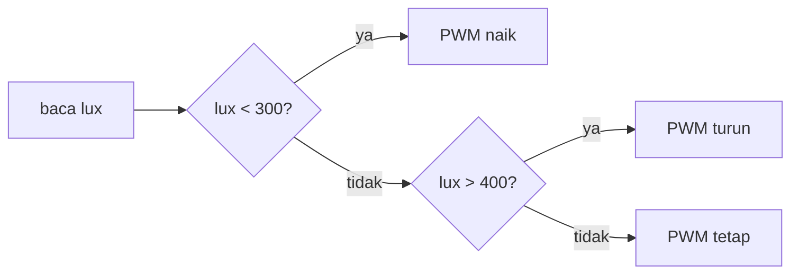
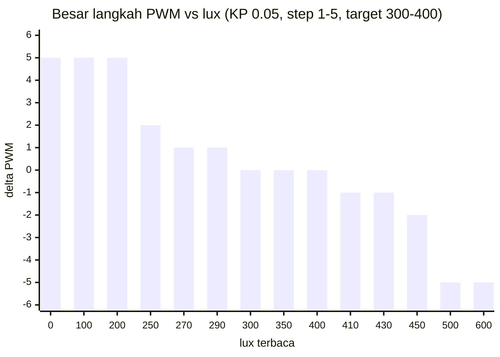
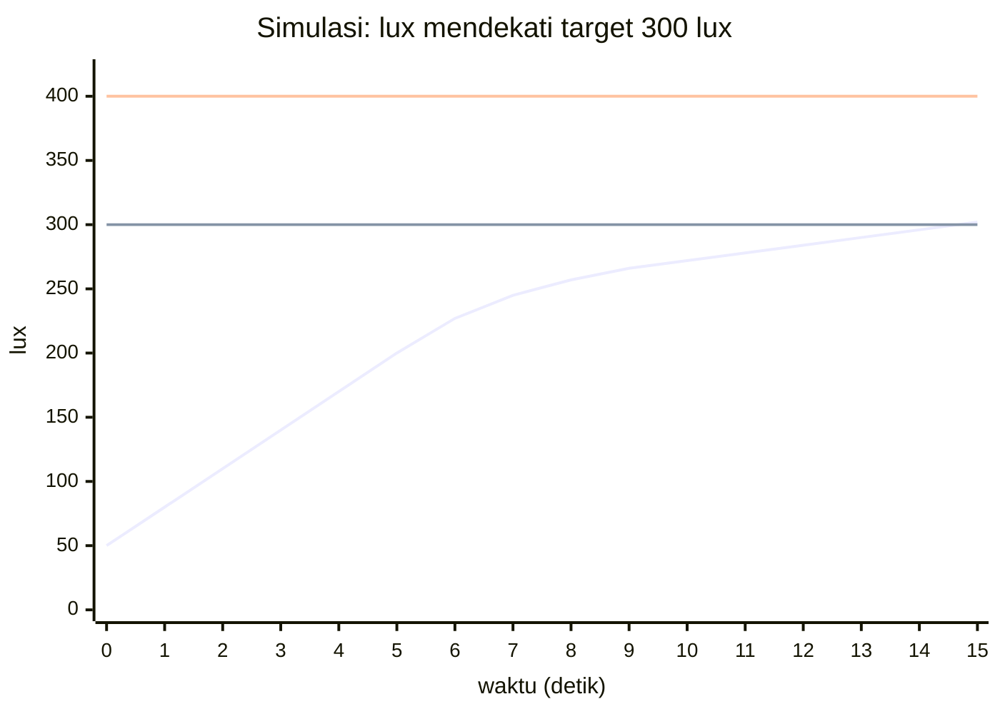

# Bab 5 — Sistem Kontrol Otomatis

Ini "jantung" dari kata *adaptive*. Fungsinya ada di `langkahKontrol()`.

## 5.1 Ide dasarnya

Setiap 0,5 detik, untuk **setiap zona**:

1. Baca sensor cahaya → dapat lux.
2. Bandingkan dengan target.
3. Terlalu gelap? Naikkan lampu sedikit. Terlalu terang? Turunkan sedikit. Sudah pas? Diamkan.

> **Perumpamaan: mengatur keran air hangat saat mandi.**
> Air terlalu dingin → putar keran panas sedikit. Tunggu sebentar, rasakan lagi. Masih dingin → putar sedikit lagi. Sudah nyaman → biarkan. Kamu tidak memutar keran 180° sekaligus, karena nanti malah kepanasan.

## 5.2 Target berupa rentang (deadband)

Target bukan satu angka, tapi **rentang**: `thBawah` sampai `thAtas` (default **300–400 lux**).

```
lux:  0 ........... 300 ======================= 400 ............ 1000
      |  TERLALU GELAP  |       ZONA NYAMAN       |  TERLALU TERANG  |
      |  -> naikkan PWM |   -> PWM tidak diubah   |  -> turunkan PWM |
```



### Kenapa harus rentang, bukan satu angka?

> **Perumpamaan: AC dengan target persis 25,0 °C.**
> Suhu 24,9 °C → AC mati. Suhu 25,1 °C → AC nyala. 24,9 → mati. 25,1 → nyala... AC akan **cetak-cetek terus**, cepat rusak.
>
> Dengan rentang 24–26 °C, AC baru bereaksi kalau benar-benar keluar dari rentang. Jauh lebih tenang.

Untuk lampu, tanpa rentang, lampu akan **naik-turun terus** (berkedip pelan) karena sensor selalu sedikit bergoyang nilainya. Rentang "aman" ini disebut **deadband**.

## 5.3 Seberapa besar langkahnya?

Besar perubahan PWM (**delta**) dihitung dari **seberapa jauh** lux dari target:

```cpp
if (lux < thBawah) {
  delta = constrain((int)((thBawah - lux) * KP), STEP_MIN, STEP_MAX);
} else if (lux > thAtas) {
  delta = -constrain((int)((lux - thAtas) * KP), STEP_MIN, STEP_MAX);
}
```

Dipecah:

1. **Selisih** = jarak lux ke batas terdekat. Contoh: lux 200, target bawah 300 → selisih 100.
2. **× KP** (default 0,05) → 100 × 0,05 = 5.
3. **Dibulatkan ke bawah** (`(int)`) → 5.
4. **`constrain(..., STEP_MIN, STEP_MAX)`** = jepit ke rentang 1–5.

> **Perumpamaan: menyetir mendekati lampu merah.** Masih jauh → rem sedikit-sedikit tapi kecepatan turun cukup banyak. Sudah dekat → rem sangat halus. Tapi ada batas: tidak pernah menginjak rem lebih dari "setengah" (`STEP_MAX`), dan kalau perlu rem, minimal disentuh sedikit (`STEP_MIN`).

### Tabel contoh (KP = 0,05, STEP 1–5)

| lux | Selisih | Selisih × KP | Setelah dibulatkan | Setelah dijepit 1–5 | Delta |
|---|---|---|---|---|---|
| 50 | 250 | 12,5 | 12 | **5** (kena batas atas) | +5 |
| 200 | 100 | 5,0 | 5 | 5 | +5 |
| 260 | 40 | 2,0 | 2 | 2 | +2 |
| 290 | 10 | 0,5 | 0 | **1** (kena batas bawah) | +1 |
| 350 | — | — | — | — | 0 (nyaman) |
| 420 | 20 | 1,0 | 1 | 1 | −1 |
| 600 | 200 | 10 | 10 | **5** | −5 |



Perhatikan: jauh dari target → langkah besar (5). Dekat target → langkah kecil (1). Di dalam rentang → 0.

### Terakhir: PWM baru

```cpp
int baru = constrain((int)nilaiCh[z] + delta, 0, (int)pwmMaks);
setChannel(z, baru);
```

PWM baru = PWM lama + delta, lalu dijepit **0 sampai `pwmMaks`**. Jadi tidak bisa minus, dan tidak bisa melewati limiter.

## 5.4 Simulasi: lampu "mencari" target

Mari kita bayangkan satu zona dengan kondisi sederhana:

- Cahaya dari luar (matahari, lampu lain) = **50 lux**.
- Setiap 1 PWM menambah **3 lux**. Jadi `lux = 50 + 3 × PWM`.
- Mulai dari PWM 0. Target 300–400 lux. `pwmMaks = 100`.

| Waktu (s) | PWM | lux | Keterangan |
|---|---|---|---|
| 0,0 | 0 | 50 | gelap sekali → +5 |
| 0,5 | 5 | 65 | +5 |
| ... | ... | ... | naik 5 terus |
| 5,0 | 50 | 200 | selisih 100 × 0,05 = 5 → +5 |
| 5,5 | 55 | 215 | 85 × 0,05 = 4,25 → +4 |
| 6,0 | 59 | 227 | +3 |
| 6,5 | 62 | 236 | +3 |
| 7,0 | 65 | 245 | +2 |
| 8,0 | 69 | 257 | +2 |
| 8,5 | 71 | 263 | 37 × 0,05 = 1,85 → +1 |
| ... | ... | ... | naik 1 terus (kena `STEP_MIN`) |
| 15,0 | 84 | 302 | **masuk zona nyaman, berhenti** |



Garis bawah adalah lux zona, dua garis datar adalah batas 300 dan 400. Terlihat lux naik **cepat di awal** lalu **melambat** saat mendekati target, persis seperti menyetir mendekati lampu merah.

### Apa yang terjadi kalau matahari tiba-tiba masuk?

Cahaya luar naik dari 50 menjadi 250 lux. Dengan PWM 84, lux sekarang 250 + 252 = **502 lux** (terlalu terang). Sistem akan menurunkan PWM 5, 5, ... lalu makin halus, sampai lux kembali di bawah 400. **Itulah adaptif.**

## 5.5 Parameter yang bisa kamu ubah

| Perintah | Variabel | Efek kalau dinaikkan | Efek kalau diturunkan |
|---|---|---|---|
| `th 300 400` | `thBawah`, `thAtas` | Ruangan lebih terang | Ruangan lebih redup, hemat listrik |
| `kp 0.05` | `KP` | Lebih agresif mendekati target | Lebih lembut, lebih lambat |
| `step 1 5` | `STEP_MIN`, `STEP_MAX` | Perubahan per langkah lebih besar → cepat tapi bisa "kelewatan" | Halus tapi lambat |
| `maks 100` | `pwmMaks` | Lampu boleh lebih terang | Lampu dibatasi lebih redup |

> **Jebakan:** Kalau target 300 lux tapi `pwmMaks` terlalu kecil, lampu tidak akan pernah cukup terang. PWM akan "mentok" di `pwmMaks` dan lux tetap di bawah 300. Itu bukan bug, tapi limiter yang bekerja.

> **Catatan:** `kp 0` **membekukan** PWM semua zona, sedangkan lux tetap dibaca dan ditampilkan. Lampu tidak mati, hanya berhenti disesuaikan. Selama `KP` lebih dari 0, selisih sekecil apa pun tetap dikoreksi minimal `STEP_MIN`. Lihat [Task 02](../../tasks/02-kp-nol-tetap-bergerak.md).
>
> ```cpp
> if (KP <= 0) continue;   // kp 0 -> koreksi dibekukan, lux tetap dimonitor
> ```

## 5.6 Kalau sensor rusak?

```cpp
if (lux < 0) continue;   // sensor error -> PWM zona ini ditahan
```

Kalau sensor zona tertentu error, zona itu **dilewati**: PWM-nya dibiarkan, zona lain tetap berjalan. Di monitor tampil `ERR`:

```
[KONTROL 300-400 lx, maks 100] Z0:312.5/84  Z1:ERR/40  Z2:355.0/61 ...
```

Cara membaca: `Z<zona>:<lux>/<pwm>`. Contoh `Z0:312.5/84` = zona 0, lux 312,5, PWM 84.

### Sensor dicoba lagi secara otomatis

Sensor yang error tidak langsung dianggap rusak selamanya. Sistem memakai dua langkah:

1. **Mendeteksi:** `bacaSensorMentah()` menghitung kegagalan beruntun di `gagalBeruntun[z]`. Setelah **3 kali gagal beruntun**, sensor ditandai gagal (`sensorOk[z] = false`). Satu kali baca berhasil mengembalikan hitungannya ke 0.
2. **Mencoba lagi:** `pulihkanSensor()` dipanggil di setiap putaran `loop()`, tetapi hanya mencoba zona yang ditandai gagal, **maksimal sekali per 5 detik per zona**.

> **Perumpamaan: menelepon teman yang tidak mengangkat.** Tiga kali tidak diangkat, kamu anggap dia sedang tidak bisa dihubungi. Kamu tidak menelepon ribuan kali per detik, cukup coba lagi tiap beberapa saat. Begitu diangkat, urusan berjalan seperti biasa.

Contoh di Serial saat kabel sensor zona 1 dicabut lalu dipasang lagi di mode KONTROL:

```
[SENSOR] Zona 1 hilang
[KONTROL 300-400 lx, maks 100] Z0:312.5/84  Z1:ERR/40  Z2:355.0/61 ...
[SENSOR] Zona 1 pulih
[KONTROL 300-400 lx, maks 100] Z0:312.5/84  Z1:298.0/41  Z2:355.0/61 ...
```

Selama `ERR`, PWM zona itu **ditahan**, supaya lampu tidak tiba-tiba mati atau berubah hanya karena kabel sensor bermasalah.

Beberapa hal yang perlu diingat:

- Setelah init ulang, bacaan **200 ms pertama** dianggap belum siap, karena BH1750 butuh waktu untuk pengukuran pertamanya.
- Di mode MANUAL dan MANUAL_IR, sensor tidak dibaca otomatis, jadi sensor yang tercabut baru terdeteksi setelah perintah `baca` gagal 3 kali.
- Kalau sensor kehilangan daya tanpa 3 kali gagal baca beruntun, sensor tidak di-init ulang otomatis.

Perintah `init` (atau `scan`) menjalankan `initSensor()` kapan saja dan mencetak hasil semua zona. Pakai perintah ini kalau bacaan sensor terlihat aneh.

## Rangkuman Bab 5

- Kontrol berjalan tiap **500 ms**, setiap zona **sendiri-sendiri**.
- Target berupa **rentang (deadband)** agar lampu tidak naik-turun terus.
- Langkah **sebanding dengan jarak** ke target (`KP`), dijepit di `STEP_MIN`–`STEP_MAX`.
- PWM selalu dijepit **0 sampai `pwmMaks`**.
- `kp 0` → PWM dibekukan, lux tetap dibaca.
- Sensor error → zona itu diam, yang lain jalan terus. Sensor yang gagal dicoba lagi otomatis.

Lanjut ke [Bab 6 — Kalibrasi Sensor](06-kalibrasi.md).
