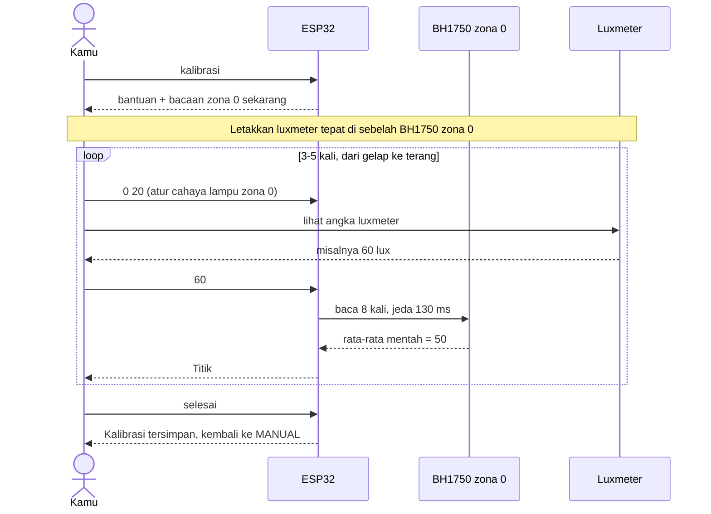
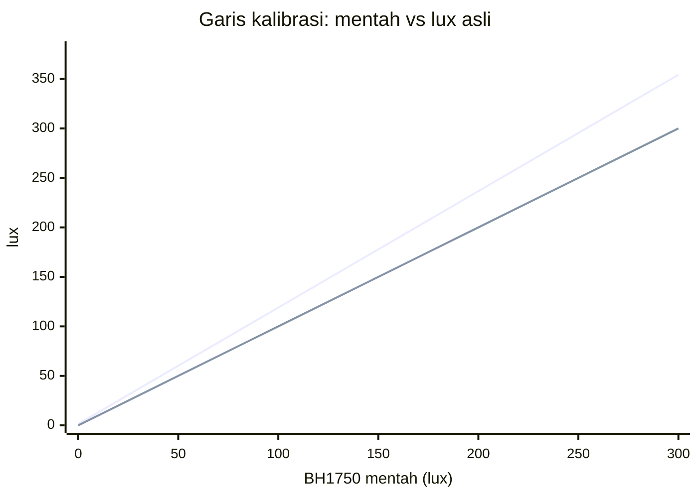
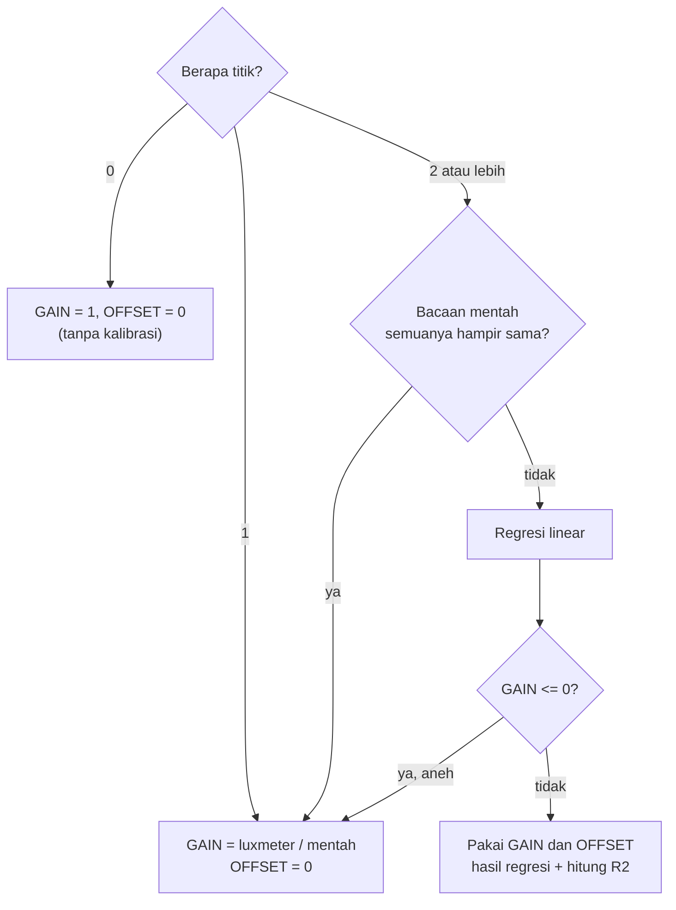

# Bab 6 — Kalibrasi Sensor

## 6.1 Kenapa perlu kalibrasi?

BH1750 itu murah dan bagus, tapi **bacaannya bisa meleset** dari nilai sebenarnya. Penyebabnya macam-macam: toleransi pabrik, tertutup difuser/kaca, sudut pemasangan, warna cahaya LED.

> **Perumpamaan: timbangan badan di rumah.**
> Kamu naik timbangan rumah: 60 kg. Di klinik (timbangan akurat): 63 kg. Coba lagi dengan barang lain: rumah 20 kg, klinik 21 kg. Kamu sadar timbangan rumah **selalu kurang sekitar 5%**. Mulai sekarang, setiap pakai timbangan rumah, kamu kalikan 1,05. Itulah **kalibrasi**.

Di sini, "timbangan klinik" adalah **luxmeter** (alat ukur cahaya yang akurat), dan "timbangan rumah" adalah **BH1750**.

## 6.2 Rumus kalibrasi

Kode memakai rumus garis lurus:

```
lux_asli = GAIN × lux_mentah + OFFSET
```

| Istilah | Arti | Perumpamaan timbangan |
|---|---|---|
| `lux_mentah` | Angka langsung dari BH1750 | Angka di timbangan rumah |
| `GAIN` | Pengali | "Selalu kurang 5%" → kali 1,05 |
| `OFFSET` | Penambah | "Jarum timbangan sudah di 1 kg padahal kosong" → kurangi 1 |
| `lux_asli` | Hasil yang dipakai sistem | Berat sebenarnya |

Tanpa kalibrasi: `GAIN = 1`, `OFFSET = 0`, artinya angka mentah dipakai apa adanya.

## 6.3 Cara mengambil titik kalibrasi



Kenapa dibaca **8 kali lalu dirata-rata** (`bacaMentahRata()`)? Karena bacaan sensor sedikit bergoyang.

> **Perumpamaan:** Mengukur tinggi badan anak yang tidak bisa diam. Ukur 8 kali lalu ambil rata-ratanya, lebih bisa dipercaya daripada sekali ukur.

## 6.4 Dari titik ke garis: regresi linear

Misalnya kamu mengambil 4 titik:

| Titik | BH1750 mentah (x) | Luxmeter (y) |
|---|---|---|
| 1 | 50 | 60 |
| 2 | 100 | 120 |
| 3 | 200 | 235 |
| 4 | 300 | 355 |

Kalau digambar, titik-titik ini **hampir** segaris, tapi tidak persis. Tugas **regresi linear** adalah mencari **satu garis lurus yang paling dekat** dengan semua titik.

> **Perumpamaan:** Kamu menaburkan beberapa butir beras di meja, lalu meletakkan sebatang lidi di atasnya sedemikian rupa agar lidinya **sedekat mungkin dengan semua butir**. Lidi itulah garis kalibrasinya.

Hasil untuk data di atas: **GAIN ≈ 1,176** dan **OFFSET ≈ 1,36**.



- Garis atas = **hasil kalibrasi** (`1,176 × mentah + 1,36`).
- Garis bawah = **tanpa kalibrasi** (mentah dipakai apa adanya).
- Jarak antara dua garis = seberapa besar sensor "meleset". Di 300 lux mentah, sensor kurang ~54 lux!

Cek titik ke-3: `1,176 × 200 + 1,36 = 236,6`. Luxmeter bilang 235. Selisih hanya 1,6 lux.

### Rumus di kode (`hitungKalibrasi()`)

Kode menghitung beberapa jumlah dulu (Σ = "jumlahkan semua"):

```
sx  = Σx       sy  = Σy
sxx = Σx²      sxy = Σ(x·y)      syy = Σy²

GAIN   = (n·sxy − sx·sy) / (n·sxx − sx²)
OFFSET = (sy − GAIN·sx) / n
```

Hitung manual dengan data di atas (n = 4):

| | Nilai |
|---|---|
| sx | 50 + 100 + 200 + 300 = **650** |
| sy | 60 + 120 + 235 + 355 = **770** |
| sxx | 2 500 + 10 000 + 40 000 + 90 000 = **142 500** |
| sxy | 3 000 + 12 000 + 47 000 + 106 500 = **168 500** |
| penyebut | 4 × 142 500 − 650² = 570 000 − 422 500 = **147 500** |
| pembilang | 4 × 168 500 − 650 × 770 = 674 000 − 500 500 = **173 500** |
| **GAIN** | 173 500 / 147 500 = **1,1763** |
| **OFFSET** | (770 − 1,1763 × 650) / 4 = **1,36** |

Tidak perlu hafal rumusnya. Yang penting paham: **"cari garis lurus terbaik dari titik-titik"**.

### R²: seberapa lurus titik-titikmu?

`R²` adalah nilai 0 sampai 1 yang menunjukkan **seberapa cocok** garis dengan titik-titik.

| R² | Arti |
|---|---|
| 0,99 – 1,00 | Sangat bagus, titik hampir persis di garis |
| 0,95 – 0,99 | Cukup baik |
| < 0,95 | Ada titik yang aneh, mungkin cahaya berubah saat mengukur. Pertimbangkan `batal` lalu ulangi |

## 6.5 Kasus khusus

Kode tidak selalu memakai regresi. Ada "jalan pintas" agar hasilnya masuk akal:



- **1 titik:** tidak bisa menggambar garis dari satu titik (bisa ke mana saja!), jadi pakai **perbandingan** saja. Contoh: mentah 100, luxmeter 120 → GAIN = 1,2.
- **Semua titik di tempat yang sama:** sama saja seperti 1 titik, karena garisnya tidak bisa ditentukan.
- **GAIN negatif:** artinya "makin terang, sensor bilang makin gelap", jelas salah. Kembali ke perbandingan.

> **Tips:** Ambil titik dari **gelap sampai terang** (misalnya 20, 100, 250, 400 lux). Titik yang menyebar membuat garis lebih akurat, seperti lidi yang lebih stabil kalau butir berasnya tersebar sepanjang meja.

## 6.6 Disimpan di mana?

Di **memori flash** ESP32 lewat library `Preferences`, sehingga **tidak hilang saat listrik mati**.

> **Perumpamaan:** RAM = papan tulis (dihapus saat pulang). Flash/Preferences = buku catatan (tetap ada besok).

```
Namespace "kalbh"
 ├─ n    = 4                         (jumlah titik)
 ├─ raw  = [50, 100, 200, 300, ...]  (bacaan mentah)
 └─ ref  = [60, 120, 235, 355, ...]  (bacaan luxmeter)
```

Yang disimpan adalah **titik-titiknya**, bukan GAIN/OFFSET. Saat boot, `muatKalibrasi()` membaca titik lalu menghitung ulang GAIN/OFFSET. Keuntungannya: kalau rumus diperbaiki di masa depan, data lama tetap bisa dipakai.

## 6.7 Keterbatasan saat ini

Kalibrasi **hanya diambil dari zona 0**, lalu GAIN/OFFSET yang sama dipakai untuk **semua 10 zona**.

> **Perumpamaan:** Kamu punya 10 timbangan rumah, tapi hanya timbangan nomor 1 yang dicocokkan ke timbangan klinik, lalu "kali 1,05" dipakai untuk kesepuluhnya. Kalau timbangan nomor 7 ternyata melesetnya 10%, hasilnya tetap salah.

Rencana perbaikannya ada di [Task 04](../../tasks/04-kalibrasi-per-zona.md).

## Rangkuman Bab 6

- Kalibrasi = mencocokkan sensor murah dengan alat akurat (luxmeter).
- Rumus: `lux_asli = GAIN × mentah + OFFSET`.
- ≥ 2 titik → **regresi linear** (garis lurus terbaik). 1 titik → perbandingan.
- **R²** menunjukkan kualitas kalibrasi (makin dekat 1, makin bagus).
- Titik disimpan di flash, GAIN/OFFSET dihitung ulang saat boot.

Lanjut ke [Bab 7 — Mode Sensor IR](07-mode-ir.md).
