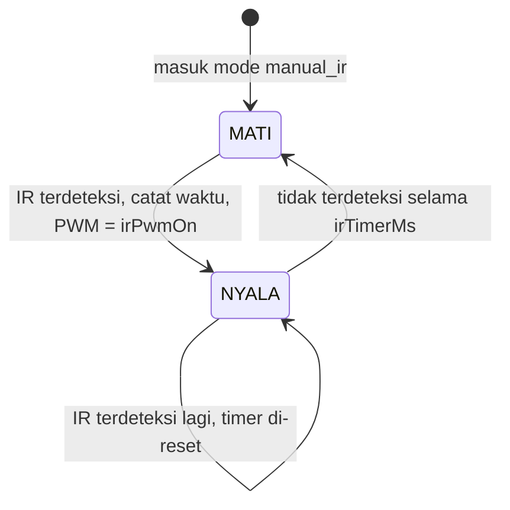

# Bab 7 — Mode Sensor IR (MANUAL_IR)

## 7.1 Ide dasarnya

> **Perumpamaan: lampu toilet di mall.**
> Kamu masuk → lampu menyala. Selama kamu bergerak, lampu tetap menyala. Kamu keluar → beberapa detik kemudian lampu mati sendiri.

Itulah mode `MANUAL_IR`, dengan satu aturan per zona:

- **Sensor IR zona z** mendeteksi → **lampu zona z** menyala.
- Setiap ada deteksi, **timer di-reset** (dihitung ulang dari awal).
- Kalau tidak ada deteksi selama `irTimerMs` (default **10 detik**) → lampu mati.

## 7.2 Timeline contoh

Timer = 10 detik. Seseorang lewat di zona 3:

```
waktu (s):   0    2    4    6    8   10   12   14   16   18   20   22   24
IR zona 3:   ____‾‾‾‾‾‾______‾‾‾‾_________________________________________
             (‾ = terdeteksi)
                 ^          ^   ^
                 |          |   terakhir terdeteksi di detik 8
                 |          terdeteksi lagi di detik 7 -> timer reset
                 pertama terdeteksi di detik 2 -> lampu ON

Lampu z3:    ____‾‾‾‾‾‾‾‾‾‾‾‾‾‾‾‾‾‾‾‾‾‾‾‾‾‾‾‾‾‾‾‾‾‾‾‾‾‾‾‾‾‾‾‾______________
                 ON                                      OFF di detik 18
                                                         (8 + 10)
```

Yang penting: lampu mati **10 detik setelah deteksi terakhir**, bukan 10 detik setelah pertama menyala.

> **Perumpamaan:** Seperti batas waktu jawab di kuis. Setiap kali kamu menjawab, waktunya diulang dari 10 detik. Kalau 10 detik diam, giliranmu habis.

## 7.3 Logika di kode: `prosesIR()`

Fungsi ini dipanggil di **setiap putaran `loop()`** (ribuan kali per detik) saat mode MANUAL_IR.

```cpp
void prosesIR(unsigned long now) {
  for (uint8_t z = 0; z < NUM_CH; z++) {
    bool deteksi = (digitalRead(IR_PIN[z]) == IR_AKTIF);

    if (deteksi) {
      irTerakhir[z] = now;             // catat "terakhir terlihat"
      if (!irNyala[z]) {               // kalau lampu masih mati
        irNyala[z] = true;
        setChannel(z, irPwmOn[z]);     // nyalakan
      }
    } else if (irNyala[z] && (now - irTerakhir[z] >= irTimerMs)) {
      irNyala[z] = false;              // sudah lama tidak terlihat
      setChannel(z, 0);                // matikan
    }
  }
}
```

### Diagram keadaan satu zona



Setiap zona punya "ingatan" sendiri:

| Variabel | Isi | Perumpamaan |
|---|---|---|
| `irNyala[z]` | Apakah lampu zona z sedang menyala karena IR | Catatan "lampu toilet 3: ON" |
| `irTerakhir[z]` | Kapan terakhir zona z mendeteksi orang | "Terakhir ada orang jam 12:00:08" |
| `irPwmOn[z]` | Seberapa terang saat menyala | Setelan terang lampu toilet 3 |

Kenapa perlu `irNyala[z]`? Supaya `setChannel()` dan pesan `[IR] ... ON` hanya dijalankan **sekali** saat lampu baru menyala, bukan ribuan kali per detik selama orangnya berdiri di situ.

## 7.4 Contoh sesi Serial

```
> manual_ir
========== MODE MANUAL_IR ==========
Semua lampu mati. Sensor IR zona z mendeteksi -> lampu CH z menyala.
...
Timer: 10.0 s | PWM maks: 100

> timer 5
>> Timer IR: 5.0 s

> 3 60
Zona 3 -> PWM saat terdeteksi: 60

(tangan di depan sensor zona 3)
[IR] Zona 3 terdeteksi -> lampu ON (PWM 60, 5.0 s)

> ir
---------- SENSOR IR ----------
Timer: 5.0 s
Zona 0 | GPIO 15 | kosong     | PWM nyala 100 | lampu OFF
...
Zona 3 | GPIO 4 | kosong     | PWM nyala 60 | lampu ON (sisa 3.2 s)
...

(5 detik kemudian)
[IR] Zona 3 timer habis -> lampu OFF
```

## 7.5 Hal yang perlu diperhatikan

1. **`3 60` di mode ini tidak langsung menyalakan lampu.** Artinya "kalau nanti terdeteksi, pakai PWM 60". Kalau lampu zona 3 sedang menyala, nilainya langsung ikut berubah.
2. **`timer` berlaku langsung**, termasuk untuk lampu yang sedang menyala.
3. **`irPwmOn` default = `pwmMaks` saat boot (100)** dan tidak ikut berubah kalau `maks` dinaikkan nanti. Lihat [Task 03](../../tasks/03-pwm-ir-tidak-ikut-maks.md).
4. **Sensor IR hanya diproses di mode MANUAL_IR.** Di mode lain, perintah `ir` tetap bisa menampilkan status sensor, tapi lampu tidak bereaksi.

## Rangkuman Bab 7

- IR terdeteksi → lampu zona itu menyala dengan `irPwmOn[z]`.
- Timer **di-reset** setiap deteksi; lampu mati `irTimerMs` setelah deteksi **terakhir**.
- `irNyala[z]` mencegah aksi "nyalakan" diulang ribuan kali.

Lanjut ke [Bab 8 — Latihan](08-latihan.md).
