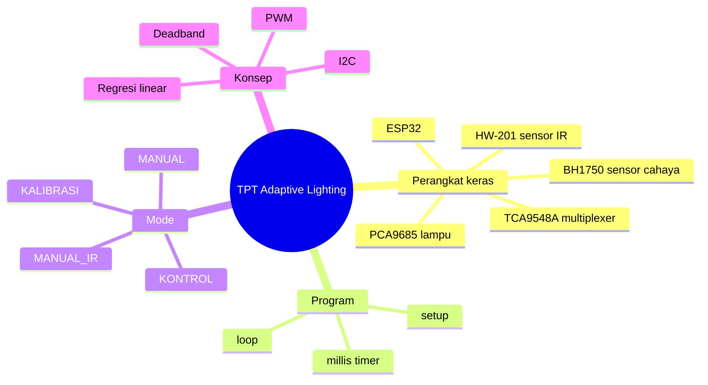

# Belajar Kode TPT Adaptive Lighting

Selamat datang! Dokumen ini membantu kamu memahami firmware `sketch_oct28c.ino` **pelan-pelan, dari gambaran besar sampai detail**, dengan banyak perumpamaan sehari-hari dan diagram.

Tidak perlu jago elektronika atau C++ dulu. Cukup tahu dasar Arduino (`setup()`, `loop()`, `Serial.print()`).

## Urutan Belajar

Baca berurutan, karena setiap bab memakai istilah dari bab sebelumnya.

| Bab | Judul | Yang dipelajari | Waktu baca |
|---|---|---|---|
| 1 | [Gambaran Besar](01-gambaran-besar.md) | Sistem ini sebenarnya ngapain? | 5 menit |
| 2 | [Perangkat Keras, I2C, dan PWM](02-perangkat-keras.md) | Cara ESP32 "ngobrol" dengan lampu dan sensor | 15 menit |
| 3 | [Alur Program](03-alur-program.md) | `setup()`, `loop()`, dan trik `millis()` | 10 menit |
| 4 | [Mode dan Perintah Serial](04-mode-dan-perintah.md) | Cara sistem membaca dan menjalankan perintah | 10 menit |
| 5 | [Sistem Kontrol Otomatis](05-sistem-kontrol.md) | Cara lampu "menyesuaikan diri" dengan cahaya | 15 menit |
| 6 | [Kalibrasi Sensor](06-kalibrasi.md) | Membuat sensor murah seakurat luxmeter | 15 menit |
| 7 | [Mode Sensor IR](07-mode-ir.md) | Lampu yang menyala saat ada orang | 10 menit |
| 8 | [Latihan](08-latihan.md) | Soal latihan untuk menguji pemahaman | bebas |

## Peta Konsep

## Tips Belajar

- Buka `sketch_oct28c.ino` di sebelah dokumen ini. Setiap bab menyebut **nama fungsi** yang dibahas, jadi kamu bisa langsung mencarinya (Ctrl+F).
- Kalau punya hardware-nya, coba langsung perintahnya di Serial Monitor. Belajar paling cepat dengan mencoba.
- Dokumen teknis yang lebih ringkas ada di [SPESIFIKASI.md](../../SPESIFIKASI.md).
